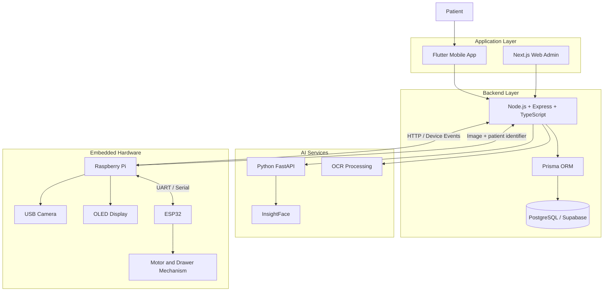
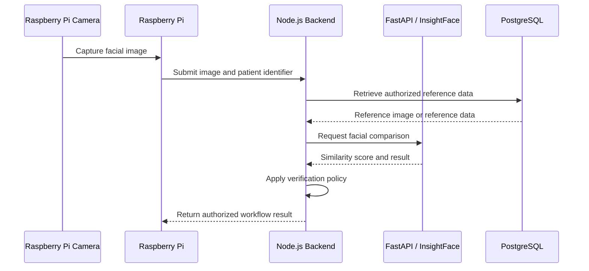

# Smart Medicine Box 💊
### AI-Powered Intelligent Medication Dispensing System

An intelligent medication management system that combines **Embedded Linux, Artificial Intelligence, Computer Vision, IoT, and Mobile Development** to help patients manage their medication schedules safely and efficiently.

The project aims to automate medication dispensing, verify patient identity, assist with prescription and medication verification, and provide real-time notifications through a mobile application.

---

## Table of Contents

- [Overview](#overview)
- [Objectives](#objectives)
- [Key Features](#key-features)
- [System Architecture](#system-architecture)
- [Technologies](#technologies)
- [Repository Structure](#repository-structure)
- [Hardware Components](#hardware-components)
- [Software Components](#software-components)
- [How It Works](#how-it-works)
- [Getting Started](#getting-started)
- [Environment Configuration](#environment-configuration)
- [API and Communication](#api-and-communication)
- [Security and Reliability](#security-and-reliability)
- [Testing](#testing)
- [Current Scope and Limitations](#current-scope-and-limitations)
- [Future Improvements](#future-improvements)
- [Contributors](#contributors)
- [Disclaimer](#disclaimer)
- [License](#license)

---

## Overview

Managing multiple medications can be challenging, particularly for elderly patients and people following complex treatment plans. Missed doses, incorrect medication selection, and expired medicines can create serious risks.

**Smart Medicine Box** is an intelligent medication dispensing solution designed to address these challenges through a connected hardware device and a software ecosystem.

The system consists of five main components:

1. **Flutter Mobile Application:** Provides patient registration, medication management, scheduling, notifications, and monitoring.
2. **Node.js Backend:** Handles application business logic, authentication, data management, and communication between system components.
3. **Next.js Web Administration Panel:** Provides an interface for administrative operations and medicine box management.
4. **AI Face Recognition Service:** Uses Python, FastAPI, and InsightFace to verify a patient's identity by comparing facial images.
5. **Embedded Medicine Box:** Uses a Raspberry Pi and ESP32-based hardware to interact with the physical device, capture images, communicate with backend services, and control hardware operations.

The system is designed with a modular architecture so that the mobile application, backend, AI service, and embedded device can evolve independently.

## Objectives

- Automate medication dispensing according to configured schedules.
- Improve patient identification using facial recognition.
- Assist with medication verification using computer vision and OCR.
- Manage medication schedules and treatment information.
- Send notifications and alerts related to medication events.
- Monitor the status of connected medicine boxes.
- Integrate embedded hardware with cloud-based application services.
- Maintain medication and device information in a structured database.

## Key Features

### Mobile Application

- User registration and authentication.
- Patient profile management.
- Medication creation and management.
- Medication schedule configuration.
- Prescription image submission and OCR-assisted verification.
- Medicine box configuration and drawer management.
- Medication event notifications and alerts.
- Treatment progress and medication history.
- Communication with the backend API.

### AI and Computer Vision

- Facial image capture using a camera.
- Patient identity verification through a dedicated AI service.
- Facial feature extraction and similarity comparison using InsightFace.
- Prescription text extraction using OCR.
- Medication expiry-date recognition and verification workflows.
- Support for integrating additional computer vision models.

*AI capabilities depend on the corresponding model, service, and hardware integration being configured and tested.*

### Embedded System

- Raspberry Pi-based device control.
- USB camera integration.
- Communication with ESP32 hardware.
- Drawer and motor control through the hardware layer.
- I2C OLED display support.
- HTTP-based communication with backend services.
- MQTT-based messaging where configured.
- Device heartbeat and status reporting.
- Linux service management using systemd.

### Backend and Administration

- REST API for application and device operations.
- Database persistence with PostgreSQL.
- Prisma ORM for database access.
- User, patient, medication, and schedule management.
- Medicine box and drawer management.
- Device communication and medication event handling.
- Administrative interfaces for managing system resources.

---

## System Architecture

The project follows a distributed architecture that separates the user interface, business logic, AI processing, and hardware control.



### Architecture Responsibilities

| Component | Responsibility |
|---|---|
| Flutter Mobile App | Patient-facing interface and medication management |
| Next.js Web Admin | Administrative operations and device management |
| Node.js Backend | Business logic, authentication, APIs, and data coordination |
| PostgreSQL | Persistent application data |
| Prisma ORM | Database access and schema management |
| FastAPI AI Service | Dedicated AI inference endpoints |
| InsightFace | Facial feature extraction and face comparison |
| Raspberry Pi | Embedded Linux application and device coordination |
| ESP32 | Low-level hardware control and peripheral integration |
| OLED Display | Local device status and user feedback |
| USB Camera | Image capture for patient verification |

**Important:** The backend is the central coordination layer. The Raspberry Pi should not need direct database credentials to perform ordinary application operations.

---

## Technologies

| Category | Technologies |
|---|---|
| Mobile Development | Flutter, Dart |
| Web Administration | Next.js, React, TypeScript |
| Backend Development | Node.js, Express.js, TypeScript |
| Database | PostgreSQL, Supabase |
| ORM | Prisma |
| AI Service | Python, FastAPI, InsightFace |
| Computer Vision | OpenCV, OCR tools |
| Embedded Platform | Raspberry Pi 4 Model B |
| Microcontroller | ESP32 |
| Embedded Operating System | Linux, Raspberry Pi OS; Yocto integration planned or under development |
| Hardware Communication | UART, I2C |
| Device Communication | HTTP/REST, MQTT |
| Service Management | systemd |
| API Testing | Postman |
| Version Control | Git, GitHub |

The exact versions and deployment requirements should be documented in each component's dependency files.

---

## Repository Structure

The repository is organized into separate modules for the different parts of the system.

```text
medicine_box/
│
├── face_recognition_model/
│   └── Python AI service and face recognition implementation
│
├── hardware codes/
│   └── ESP32 firmware and hardware control code
│
├── mobile app/
│   └── Flutter mobile application
│
├── server/
│   └── Node.js, Express, TypeScript and Prisma backend
│
├── web admin app/
│   └── Next.js administration interface
│
└── README.md
```

### Module Responsibilities

- **`face_recognition_model/`**: AI inference, facial image processing, and identity verification.
- **`hardware codes/`**: Microcontroller firmware and hardware-specific operations.
- **`mobile app/`**: Mobile user interface, authentication, medication schedules, and notifications.
- **`server/`**: REST endpoints, business rules, database access, and device integration.
- **`web admin app/`**: Web-based administrative interface.

Additional documentation, deployment files, embedded Linux configurations, and automated tests can be added as the project evolves.

---

## Hardware Components

The hardware layer is responsible for connecting the software system to the physical medicine box.

| Component | Purpose |
|---|---|
| Raspberry Pi 4 Model B | Main embedded Linux computer |
| ESP32 | Microcontroller for hardware interactions |
| USB Camera | Captures images for facial verification |
| OLED Display | Displays local status and feedback |
| Motor / Actuator | Drives the drawer mechanism |
| Drawer Mechanism | Stores and dispenses medication |
| Power Supply | Powers the embedded components |
| Connecting Wires and Interfaces | Connects the camera, display, controller, and peripherals |

Additional sensors can be integrated to monitor drawer conditions, medication quantity, or other device parameters, depending on the implemented hardware.

---

## Software Components

### 1. Flutter Mobile Application

The mobile application is the main interface for patients.

Its responsibilities include:

- Account registration and login.
- Patient profile management.
- Creating and updating medications.
- Configuring medication schedules.
- Displaying medication events and alerts.
- Managing medicine box configuration.
- Communicating with the backend through REST APIs.

**Development requirements**

- Flutter SDK
- Dart SDK
- Android Studio or Visual Studio Code
- Android emulator or physical Android device

### 2. Node.js Backend

The backend coordinates the application's business logic and data access.

Its responsibilities include:

- Authentication and authorization.
- User and patient management.
- Medication and schedule management.
- Medicine box and drawer operations.
- Device status and heartbeat handling.
- Medication event processing.
- Communication with the AI service.
- Database validation and persistence.

**Development requirements**

- Node.js 20 or a compatible project-supported version
- npm
- PostgreSQL or a configured Supabase PostgreSQL database
- Prisma CLI
- Environment variables for secrets and service configuration

### 3. Web Administration Application

The administration interface is intended for authorized users who manage system resources and medicine boxes.

Potential responsibilities include:

- Viewing registered users and patients.
- Provisioning medicine boxes.
- Managing device assignments.
- Monitoring device status.
- Reviewing medication-related events.

Access to administrative operations must be enforced by the backend, not merely hidden in the frontend.

### 4. Face Recognition Service

The face recognition service uses Python and FastAPI to isolate computationally intensive facial verification from the embedded device.

The intended processing flow is:

1. Receive a facial image and the relevant patient identifier through the backend workflow.
2. Retrieve the authorized reference image.
3. Process the images using InsightFace.
4. Extract and compare facial representations.
5. Return a similarity score and verification result.
6. Let the backend apply the configured verification policy.

A similarity score is not a probability that two images show the same person. Thresholds must be calibrated and tested using representative images and realistic lighting conditions.

### 5. Embedded Device Software

The Raspberry Pi coordinates the physical device and its communication with the rest of the system.

Its responsibilities include:

- Camera initialization and image capture.
- Sending images to the configured backend endpoint.
- Receiving or processing authorized device commands.
- Communicating with the ESP32 over serial/UART.
- Updating the OLED display.
- Reporting device status and medication events.
- Running required processes through systemd.

The ESP32 handles the low-level operations assigned to the microcontroller, such as motor-control signals and peripheral interactions.

---

## How It Works

### Patient Medication Workflow

1. The patient registers or logs in through the mobile application.
2. The patient or an authorized caregiver configures medication information and schedules.
3. The application sends the information to the backend.
4. The backend validates and stores the data.
5. At the appropriate time, the system identifies the medication event that requires attention.
6. The medicine box captures a facial image when identity verification is required.
7. The AI service compares the captured image with the authorized reference image.
8. The backend evaluates the verification result and the applicable dispensing rules.
9. The device executes an authorized operation through its hardware-control layer.
10. The system records the resulting event and updates the application when the corresponding integration is available.

The actual sequence depends on the implemented dispensing state machine and device communication protocol. Identity verification alone must never be treated as authorization to dispense medication.

### Facial Verification Workflow



This diagram describes the intended workflow. Actual endpoint paths, payloads, authentication requirements, and error handling must match the implementation in the repository.

---

## Getting Started

The project contains multiple independently developed applications. Each component should be configured and started separately.

### Prerequisites

Install the tools required for the components you intend to run:

- Git
- Node.js and npm
- Flutter and Dart
- Python 3
- PostgreSQL or a configured Supabase project
- A supported Python environment for InsightFace and its dependencies
- ESP32-compatible development tools, such as Arduino IDE or PlatformIO, if required by the firmware
- Raspberry Pi hardware or an appropriate development environment for embedded testing

### 1. Clone the Repository

```bash
git clone <YOUR_REPOSITORY_URL>
cd medicine_box
```

Replace `<YOUR_REPOSITORY_URL>` with the actual GitHub repository URL.

### 2. Configure the Backend

```bash
cd server
npm install
```

Create a `.env` file using the variables required by the backend's configuration.

For example:

```env
DATABASE_URL="YOUR_POSTGRESQL_CONNECTION_STRING"
DIRECT_URL="YOUR_DIRECT_DATABASE_CONNECTION_STRING"
PORT=3000
NODE_ENV=development
```

These variable names are examples. Keep the names and database connection format consistent with the actual Prisma schema and backend configuration.

Generate the Prisma client and apply the project's database migrations:

```bash
npx prisma generate
npx prisma migrate deploy
```

Use `npx prisma migrate dev` in a local development environment when creating and testing new migrations.

Start the backend using the script defined in `package.json`, for example:

```bash
npm run dev
```

Do not run production migrations against an unintended database. Database commands are wonderfully efficient at destroying the wrong thing.

### 3. Configure the Face Recognition Service

```bash
cd face_recognition_model
python -m venv .venv
```

Activate the environment.

**Linux / macOS**

```bash
source .venv/bin/activate
```

**Windows PowerShell**

```powershell
.venv\Scripts\Activate.ps1
```

Install the dependencies specified by the service's `requirements.txt`, if present:

```bash
pip install -r requirements.txt
```

Start the FastAPI application using the actual Python module and application variable defined in the repository. For example:

```bash
uvicorn main:app --host 0.0.0.0 --port 8000
```

The command above assumes that the entry point is `main.py` and the FastAPI instance is named `app`. Adapt it to the real implementation.

Test the service using its configured health or verification endpoint.

### 4. Configure the Flutter Mobile Application

```bash
cd "mobile app"
flutter pub get
flutter doctor
flutter run
```

Configure the API base URL for the target environment.

For example:

- Android emulator: use the host address accessible from the emulator, commonly `10.0.2.2` for a backend running on the development computer.
- Physical Android device: use the development computer's reachable LAN IP address.
- Production: use the deployed backend's HTTPS endpoint.

`localhost` on a physical phone refers to the phone itself, not the developer's computer. This tiny networking detail has wasted a frankly impressive amount of human life.

### 5. Configure the Web Administration Application

```bash
cd "web admin app"
npm install
```

Configure the backend API URL using the environment-variable name expected by the Next.js application.

Start the application with the script defined in `package.json`, for example:

```bash
npm run dev
```

### 6. Configure the ESP32 Firmware

1. Open the firmware project in the supported development environment.
2. Configure the required board and serial communication parameters.
3. Set the correct GPIO assignments for the connected hardware.
4. Configure any required MQTT broker and backend communication settings.
5. Compile and upload the firmware.
6. Test motor-control operations and serial communication independently before connecting them to the full system.

### 7. Configure the Raspberry Pi

On the Raspberry Pi:

1. Install and configure the required Linux environment.
2. Connect and test the USB camera.
3. Configure I2C and UART interfaces as needed.
4. Install the required device-side dependencies.
5. Configure the backend endpoint and device credentials.
6. Test communication with the backend.
7. Configure systemd services for the device processes.
8. Verify recovery behavior after network loss and reboot.

Yocto can be used as the embedded Linux build system when its layers, machine configuration, and image recipes are ready for the target hardware.

---

## Environment Configuration

Never commit real credentials, API keys, patient data, or private images to GitHub.

A `.env.example` file should document the configuration variables needed by each component without containing real secrets.

Example backend configuration:

```env
NODE_ENV=development
PORT=3000

DATABASE_URL=
DIRECT_URL=

FACE_RECOGNITION_SERVICE_URL=
MQTT_BROKER_URL=
```

Example mobile configuration:

```env
API_BASE_URL=
```

These are illustrative names, not a guarantee that the current code reads these exact variables.

For a real deployment:

- Use HTTPS for network communication.
- Protect database credentials.
- Authenticate device requests.
- Restrict administrative operations.
- Store face reference images securely.
- Avoid logging sensitive patient information.
- Separate development, testing, and production environments.

---

## API and Communication

The system uses HTTP/REST for application and service communication, with MQTT available for supported messaging workflows and UART/I2C for hardware integration.

The following table describes the API domains intended for the system. Consult the backend source code for the definitive route list.

| Domain | Purpose |
|---|---|
| Authentication | Registration, login, and access control |
| Users and Patients | Profile and patient information |
| Medications | Medication information and management |
| Schedules | Medication timing and treatment configuration |
| Medicine Boxes | Device provisioning and activation |
| Drawers | Drawer configuration and associations |
| Device Events | Medication events and operational updates |
| Device Heartbeat | Device availability and status reporting |
| Face Verification | Patient identity verification workflow |

### Communication Principles

- The mobile and web applications communicate with the backend API.
- The backend accesses application data through Prisma.
- The AI service handles face comparison independently of the mobile UI.
- The Raspberry Pi communicates with the backend using authenticated requests.
- The ESP32 communicates with the Raspberry Pi through the configured hardware interface.
- MQTT topics, message formats, and device commands should be documented alongside the corresponding implementations.

Do not expose the AI service or database directly to untrusted clients unless a deliberate, secured architecture requires it.

---

## Security and Reliability

Because the system handles health-related information and can interact with physical dispensing hardware, reliability and security are core requirements rather than optional polish.

Recommended safeguards include:

- **Authentication:** Verify the identity of application users and connected devices.
- **Authorization:** Enforce role-based access control on the backend.
- **Patient privacy:** Encrypt sensitive data in transit and protect stored images.
- **Face verification:** Calibrate thresholds and evaluate false acceptance and false rejection rates.
- **Dispensing safety:** Require explicit authorization before motor activation.
- **Fail-safe operation:** Keep the dispensing mechanism in a safe state when verification, communication, or hardware control fails.
- **Event traceability:** Record important dispensing decisions, device actions, and failures.
- **Network resilience:** Handle timeouts, retries, duplicate requests, and offline operation.
- **Input validation:** Validate uploaded images, identifiers, API payloads, and device messages.
- **Operational monitoring:** Detect unavailable services, failed requests, and disconnected devices.

Facial recognition should not be the sole safety mechanism for a medication dispensing decision.

---

## Testing

Testing should cover individual components and end-to-end interactions.

### Backend

- Authentication and authorization tests.
- Medication and schedule validation.
- Database persistence and migration tests.
- Device heartbeat and event handling.
- API error handling and invalid payloads.

### AI Service

- Face detection and image preprocessing.
- Comparison of reference and captured images.
- Threshold calibration using representative test samples.
- Handling of missing, corrupt, or unsupported images.
- API timeout and inference failure handling.

### Mobile Application

- Login and registration flows.
- Medication creation and editing.
- Schedule configuration and display.
- API error and network-disconnection handling.
- Notifications and medication-event display.

### Embedded Hardware

- Camera initialization and image capture.
- UART communication between the Raspberry Pi and ESP32.
- OLED display operation.
- Motor movement and limit handling.
- Device reboot and service recovery.
- Safe behavior during network or verification failures.

### Integration Testing

Validate the complete workflow from medication scheduling through patient verification, backend authorization, hardware operation, and event reporting.

A feature should be described as complete only when its expected behavior has been tested in the relevant environment.

---

## Current Scope and Limitations

The repository brings together mobile, backend, AI, web administration, and hardware components. Their implementation and integration status may differ.

Before deployment, verify:

- Which features are implemented and tested.
- Which services require additional configuration.
- Whether all hardware components are connected and operational.
- Whether the embedded Linux image and systemd services are finalized.
- Whether AI verification has been evaluated under realistic conditions.
- Whether medication schedules and dispensing authorization are consistent across the backend and device.
- Whether the project has a complete automated test suite.

This README documents the intended architecture and development workflow. It does not claim that every listed capability is production-ready.

---

## Future Improvements

Potential improvements include:

- Finalizing a reproducible Yocto-based embedded Linux image.
- Improving facial verification accuracy and robustness.
- Integrating more reliable prescription OCR and expiry-date recognition.
- Adding sensor-based medication quantity monitoring.
- Implementing robust offline behavior and synchronization.
- Adding comprehensive automated integration tests.
- Improving device telemetry and monitoring.
- Strengthening audit trails and access-control policies.
- Adding CI/CD pipelines for the backend, mobile application, and AI service.
- Creating deployment documentation and hardware assembly guides.

---

## Contributors

This project is developed as an engineering project combining software engineering, artificial intelligence, embedded systems, and IoT.

Add the project contributors and their GitHub profiles here.

- **Project Team:** Smart Medicine Box Development Team
- **Institution:** ESPRIT, Tunisia
- **Project Type:** Engineering Project / PFA

---

## Disclaimer

Smart Medicine Box is an engineering project intended to support medication management and dispensing workflows.

It is **not a certified medical device** and must not replace professional medical advice, prescription instructions, or pharmacist supervision.

AI-based identity verification and medication recognition can produce incorrect results. Any real-world dispensing deployment requires appropriate safety validation, privacy protection, and clinical and regulatory review.

---

## License

No license has been specified yet.

Before making the repository open source, select an appropriate license and add a `LICENSE` file. Until then, do not assume that the code is freely reusable simply because the repository is publicly accessible.

---

**Smart Medicine Box: Bringing together intelligent software, embedded hardware, and safer medication management.**
